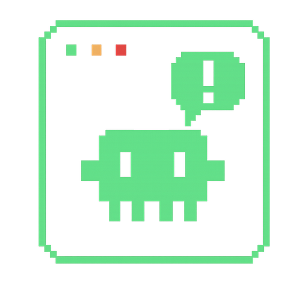

# Vigil

[English](README.md)

Un compagnon Windows pour les agents de code en ligne de commande.

Vigil reste en haut de l’écran sous la forme d’un notch, toujours au premier plan, et s’ouvre en panneau quand le détail est utile. Chaque CLI pris en charge lance un petit hook Vigil sur ses propres événements. Le hook parle à Vigil par un tube nommé local, et Vigil affiche ce que fait l’agent : en cours, en attente d’une décision, inactif, terminé, ou en erreur.



La version des sources est la **1.7.0**.

## Ce que Vigil permet

- Suivre plusieurs agents à la fois, ou ne garder dans le notch que l’agent prioritaire. Les sous-agents peuvent être affichés ou masqués, et le notch peut se cacher quand plus rien ne tourne.
- Ouvrir le détail d’une conversation. Là où le CLI le permet : approuver ou refuser un appel d’outil, répondre à une question, ou interrompre le tour.
- Revenir au terminal qui porte l’agent.
- Relire les sessions passées, regroupées par projet, avec des statistiques locales de tokens quand le CLI les écrit sur le disque.
- Lire les quotas d’usage en direct, et éventuellement afficher le quota d’un outil dans le notch.
- Choisir une mascotte pixel, une couleur et un son par état, pour chaque outil.
- Recevoir un court statut sur son téléphone via un bot Telegram créé soi-même. Le jeton du bot reste dans le gestionnaire d’identifiants Windows. Le message est le même libellé court que le notch : pas de secret, pas de source, pas de contenu de fichier, pas de sortie d’outil.
- Démarrer avec Windows, réparer les hooks au lancement, et être prévenu d’une version plus récente publiée sur le dépôt des releases.

Vigil est une application Windows (installeur NSIS, tubes nommés Win32, icône de barre des tâches). Ce n’est pas une application Linux ou macOS.

## CLI compatibles

Les hooks ne sont écrits qu’après confirmation du diff que Vigil s’apprête à poser dans la configuration de ce CLI.

| CLI | Hook | Dans cette version |
|---|---|---|
| Claude Code | `vigil-claude` | Suivi, approuver / refuser, répondre aux questions, interrompre le tour, sous-agents, erreurs d’API, historique, statistiques, usage. En option : démarrer plus tôt une fenêtre d’usage de 5 heures déjà fermée (cela consomme quelques tokens). |
| Codex CLI | `vigil-codex` | Suivi, approuver / refuser, sous-agents, historique, statistiques, usage. |
| Grok Build | `vigil-grok` | Suivi, sous-agents, erreurs d’API, historique, statistiques, usage. L’approbation depuis Vigil est complète en mode always-approve ; dans le mode par défaut, la demande est affichée en lecture seule et se confirme dans le terminal. Les questions sont en lecture seule. |
| Antigravity CLI | `vigil-antigravity` | Suivi, historique, et usage lu sur le processus local `agy`. Pas d’approbation, et pas de statistiques de tokens locales. |
| Kimi CLI | `vigil-kimi` | Suivi, sous-agents, historique, statistiques. L’approbation depuis Vigil est complète en mode yolo ; en mode manual ou auto, la demande est affichée en lecture seule. Pas de vue d’usage. |

## Téléchargement

Les installeurs sont publiés à part de ce dépôt de sources :

**[github.com/steven62f/vigil-releases/releases/latest](https://github.com/steven62f/vigil-releases/releases/latest)**

Les sources de ce dépôt sont en version 1.7.0. L’installeur s’installe pour l’utilisateur courant (sans compte administrateur) et propose le français et l’anglais.

Après l’installation, Vigil reste dans la zone de notification. Ouvrir la page Installation du panneau, activer chaque CLI détecté, puis confirmer le diff de configuration. Le CLI lance ensuite le hook `vigil-*.exe` correspondant.

## Compiler les sources

La compilation de l’application se fait sous **Windows**.

- [Rust](https://rustup.rs/) (toolchain stable ; la CI utilise stable)
- Node.js 20 (la CI utilise 20) et npm
- Les [Microsoft C++ Build Tools](https://visualstudio.microsoft.com/visual-cpp-build-tools/), avec la toolchain MSVC et le SDK Windows
- WebView2, déjà présent sur Windows 11. Sur Windows 10, installer le runtime Evergreen s’il manque.
- La CLI Tauri 2, fournie par la dépendance npm `@tauri-apps/cli`. Pas d’installation globale.

```bash
git clone https://github.com/steven62f/vigil-app.git
cd vigil-app
npm install
npm test
npm run tauri dev
```

`npm run tauri dev` lance Vite et les fenêtres natives ensemble.

Une build de release compile d’abord les cinq binaires de hook, puis produit l’installeur NSIS. `src-tauri/tauri.conf.json` embarque ces exécutables depuis `target/release/`.

```bash
npm run build:release
```

Cette commande correspond à :

```bash
cargo build --release -p vigil-claude -p vigil-codex -p vigil-grok -p vigil-antigravity -p vigil-kimi
npm run tauri build
```

`set-version.ps1` aligne la version dans `package.json`, `src-tauri/Cargo.toml` et `src-tauri/tauri.conf.json`.

Les tests frontend (`npm test`, Vitest) tournent sur n’importe quelle plateforme. Le workspace Rust et l’installeur se compilent sous Windows, parce que les hooks et l’application appellent des API Win32.

GitHub Actions (`.github/workflows/build.yml`) tourne sur `windows-latest` à chaque push : build frontend, Vitest, build release des hooks, `cargo build --workspace` et `cargo test --workspace`. L’installeur NSIS n’y est pas produit.

## Structure du projet

```
src/                  Interface React : notch, panneau, réglages, historique, usage, statistiques
src-tauri/            Application Tauri 2 : fenêtres, tray, tube nommé, état des agents, installation des hooks
vigil-hook-core/      Code partagé par tous les binaires de hook
vigil-claude/         Hook Claude Code
vigil-codex/          Hook Codex CLI
vigil-grok/           Hook Grok Build
vigil-antigravity/    Hook Antigravity CLI
vigil-kimi/           Hook Kimi CLI
docs/                 Notes en français (architecture, pipeline des hooks, notch, hooks Claude)
.github/workflows/    CI Windows
```

`docs/architecture-overview.md` et `docs/hook-pipeline.md` décrivent le tube et les trois premiers hooks. Antigravity CLI et Kimi CLI suivent le même schéma ; le tableau ci-dessus et `src/windows/panel/pages/ToolCard.tsx` font foi pour les capacités actuelles.

## Réseau

Le suivi lui-même reste sur la machine (hooks, tube nommé, transcripts locaux). Ces fonctions sortent du poste :

- **Le suivi d’usage** lit le fichier d’identifiants que le CLI a déjà enregistré et interroge le fournisseur : `api.anthropic.com` pour Claude Code, `chatgpt.com` pour Codex, `cli-chat-proxy.grok.com` pour Grok. L’usage Antigravity est lu sur le processus local `agy`, pas chez Google.
- **L’amorçage de fenêtre** (Claude Code seulement, désactivé tant qu’on ne l’active pas) envoie un message minimal à `api.anthropic.com` quand la fenêtre de 5 heures est fermée.
- **Telegram** envoie le libellé court du notch à `api.telegram.org` une fois un bot personnel appairé.
- **La recherche de mise à jour** lit l’API GitHub publique de `steven62f/vigil-releases`. Elle n’envoie pas de jeton.

## Contribution

Les issues et les pull requests sont les bienvenues. Lancer `npm test` avant d’envoyer un changement, et sous Windows `cargo test --workspace`.

## Licence

[MIT](LICENSE). Copyright 2026 Steven Hanquez.
