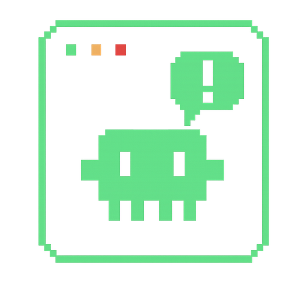

# Vigil

[Français](README.fr.md)

A Windows desktop companion for CLI coding agents.

Vigil sits at the top of the screen as a small always-on-top notch, and opens into a panel when you need the detail. Each supported CLI runs a small Vigil hook on its own events. The hook reports over a local named pipe, and Vigil shows what the agent is doing: working, waiting for a decision, idle, ended, or in error.



The current source release is **1.7.0**.

## What you can do

- Watch several agents at once, or keep the notch on the highest-priority one. Sub-agents can be shown or hidden, and the notch can hide itself when nothing is running.
- Open a detail view for the conversation. Where the CLI allows it, approve or deny a tool call, answer a question, or interrupt the turn.
- Jump back to the terminal that owns the agent.
- Browse past sessions by project, with local token statistics where the CLI writes them to disk.
- Read live usage quotas, and optionally show one tool’s quota on the notch.
- Give each tool its own pixel mascot, state color, and sound.
- Get a short status on your phone through a Telegram bot you create yourself. The bot token stays in Windows Credential Manager. The message is the same short label the notch already shows: no secrets, source, file contents, or tool output.
- Start with Windows, repair hooks on launch, and hear about a newer build published on the releases repository.

Vigil is a Windows application (NSIS installer, Win32 named pipes, system tray). It does not run as a Linux or macOS app.

## Compatible CLIs

Hooks are installed only after you confirm the diff Vigil is about to write into that CLI’s own config.

| CLI | Hook | In this version |
|---|---|---|
| Claude Code | `vigil-claude` | Monitoring, approve / deny, answering questions, interrupting the turn, sub-agents, API errors, history, statistics, usage. Optional: start a closed 5-hour usage window early (uses a few tokens). |
| Codex CLI | `vigil-codex` | Monitoring, approve / deny, sub-agents, history, statistics, usage. |
| Grok Build | `vigil-grok` | Monitoring, sub-agents, API errors, history, statistics, usage. Approve / deny from Vigil is fully active in always-approve mode; in the default mode the request is shown read-only and you confirm it in the terminal. Questions are shown read-only. |
| Antigravity CLI | `vigil-antigravity` | Monitoring, history, and usage read from the local `agy` process. No approve / deny, and no local token statistics. |
| Kimi CLI | `vigil-kimi` | Monitoring, sub-agents, history, statistics. Approve / deny from Vigil is fully active in yolo mode; in manual or auto mode the request is shown read-only. No usage view. |

## Download

Installers are published separately from this source repository:

**[github.com/steven62f/vigil-releases/releases/latest](https://github.com/steven62f/vigil-releases/releases/latest)**

The source tree in this repository is version 1.7.0. The installer is per-user (no administrator account required) and is available in English and French.

After installation, Vigil lives in the system tray. Open the panel’s Installation page, turn on each CLI that Vigil detected, and confirm the config diff. From then on, that CLI launches the matching `vigil-*.exe` hook.

## Build from source

Building the app requires **Windows**.

- [Rust](https://rustup.rs/) (stable toolchain; CI uses stable)
- Node.js 20 (CI uses 20) and npm
- The [Microsoft C++ Build Tools](https://visualstudio.microsoft.com/visual-cpp-build-tools/) with the MSVC toolchain and the Windows SDK
- WebView2, already present on Windows 11. On Windows 10, install the Evergreen runtime if it is missing.
- The Tauri 2 CLI, installed as the npm dev dependency `@tauri-apps/cli`. You do not install it globally.

```bash
git clone https://github.com/steven62f/vigil-app.git
cd vigil-app
npm install
npm test
npm run tauri dev
```

`npm run tauri dev` starts Vite and the native windows together.

A release build compiles the five hook binaries first, then packages the NSIS installer. `src-tauri/tauri.conf.json` bundles those executables from `target/release/`.

```bash
npm run build:release
```

That script is:

```bash
cargo build --release -p vigil-claude -p vigil-codex -p vigil-grok -p vigil-antigravity -p vigil-kimi
npm run tauri build
```

`set-version.ps1` writes the same version into `package.json`, `src-tauri/Cargo.toml`, and `src-tauri/tauri.conf.json`.

Frontend tests (`npm test`, Vitest) run on any platform. The Rust workspace and the installer build on Windows, because the hooks and the app call Win32 APIs.

GitHub Actions (`.github/workflows/build.yml`) runs on `windows-latest` for every push: frontend build, Vitest, a release build of the hooks, `cargo build --workspace`, and `cargo test --workspace`. It does not produce the NSIS installer.

## Project layout

```
src/                  React UI: notch, panel, settings, history, usage, statistics
src-tauri/            Tauri 2 app: windows, tray, named pipe, agent state, hook install
vigil-hook-core/      Shared code for every hook binary
vigil-claude/         Claude Code hook
vigil-codex/          Codex CLI hook
vigil-grok/           Grok Build hook
vigil-antigravity/    Antigravity CLI hook
vigil-kimi/           Kimi CLI hook
docs/                 French notes (architecture, hook pipeline, notch layout, Claude hooks)
.github/workflows/    Windows CI
```

`docs/architecture-overview.md` and `docs/hook-pipeline.md` describe the pipe and the original three hooks. Antigravity CLI and Kimi CLI follow the same shape; the tables above and `src/windows/panel/pages/ToolCard.tsx` are the current capability list.

## Network

Monitoring itself stays on the machine (hooks, named pipe, local transcripts). These features call out:

- **Usage tracking** reads the credential file the CLI already stored and queries that provider: `api.anthropic.com` for Claude Code, `chatgpt.com` for Codex, `cli-chat-proxy.grok.com` for Grok. Antigravity usage is read from the local `agy` process, not from Google.
- **Usage-window priming** (Claude Code only, off unless you enable it) sends a minimal message to `api.anthropic.com` when the 5-hour window is closed.
- **Telegram** sends the short notch label to `api.telegram.org` after you pair a bot you created.
- **Update check** reads the public GitHub API for `steven62f/vigil-releases`. It does not send a token.

## Contributing

Issues and pull requests are welcome. Run `npm test` before sending a change, and on Windows also `cargo test --workspace`.

## License

[MIT](LICENSE). Copyright 2026 Steven Hanquez.
